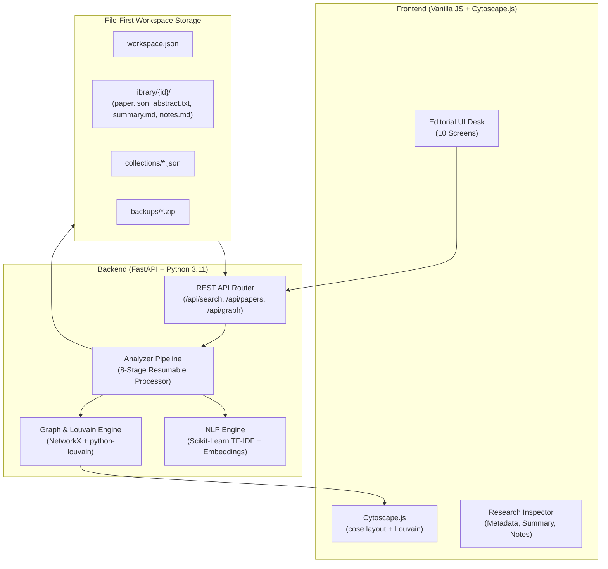

# PaperGraph

**Local-First Research Intelligence and Scientific Knowledge Graph Platform**

PaperGraph transforms academic literature into an organized, searchable, and analyzable research workspace on your computer. It functions as a personal scientific research laboratory—giving researchers, students, and analysts full ownership of their literature data without requiring cloud databases, external subscriptions, or third-party servers.

---

## 1. Project Introduction

Scientific research requires reading across disciplines, tracking citations, discovering topic intersections, and preserving synthesis notes. However, most modern research tools store notes and citations inside proprietary cloud databases, require complex local database configurations, or lock synthesis data behind subscription platforms.

PaperGraph is designed around a **file-first philosophy**: all authoritative research data—papers, reconstructed abstracts, structured summaries, vector embeddings, and annotations—is stored directly in ordinary, human-readable files (JSON, Markdown, and TXT) in a folder of your choice.

---

## 2. What PaperGraph Does

PaperGraph provides an end-to-end local research workflow:

- **Discovers Literature**: Connects to the OpenAlex academic catalog to search over 250 million scholarly publications.
- **Imports to Local Storage**: Copies metadata and abstracts into your designated local workspace.
- **Synthesizes Research Summaries**: Generates structured, eight-section analytical summaries from paper abstracts and metadata.
- **Performs NLP Analysis**: Extracts scientific keywords, domains, and research methodologies using Scikit-learn TF-IDF analysis, with support for dense embeddings.
- **Maps Interactive Graphs**: Visualizes citation networks and semantic relationships using Cytoscape.js and Louvain community detection.
- **Identifies Candidate Intersections**: Highlights potential cross-disciplinary connections between different scientific fields with supporting evidence.
- **Tracks Temporal Trends**: Aggregates publication activity over time, top methodologies, and keyword distributions.
- **Operates Offline**: Once papers are imported, your library, notes, summaries, and graphs remain fully accessible without an internet connection.

---

## 3. Feature Overview

| Capability | Implementation Status | Storage / Mechanism | Internet Required? |
| :--- | :--- | :--- | :--- |
| **OpenAlex Literature Search** | Implemented | Live API query (cached in `cache/openalex/`) | Yes |
| **Abstract Reconstruction** | Implemented | Reconstructed from OpenAlex inverted index | No (post-retrieval) |
| **File-First Library** | Implemented | Ordinary JSON, Markdown, and TXT files | No |
| **8-Section Summary Generator** | Implemented | Deterministic analytical synthesis | No |
| **Keyword & Domain Extraction** | Implemented | Scikit-learn TF-IDF n-grams & domain mappings | No |
| **Dense Vector Embeddings** | Implemented | CPU-normalized feature projection (Dense SVD) | No |
| **SentenceTransformers Engine** | Optional Extension | `all-MiniLM-L6-v2` (lazy loaded if installed) | One-time download |
| **Interactive Knowledge Graph** | Implemented | Cytoscape.js (`cose` layout) & Louvain clustering | No (bundled locally) |
| **Candidate Intersections** | Implemented | Cross-domain semantic & keyword overlap | No |
| **Temporal Trend Analytics** | Implemented | Pandas data aggregation & CSS visual charts | No |
| **Research Collections** | Implemented | Dedicated collection index files | No |
| **User Annotations** | Implemented | Preserved in `notes.md` per paper | No |
| **Academic Exports** | Implemented | BibTeX (`.bib`), JSON, CSV, and Markdown (`.md`) | No |
| **Workspace Backup / Restore** | Implemented | ZIP snapshots in `backups/` | No |
| **Full-Text PDF Parsing** | Planned Future Work | Not currently in v4.0 | N/A |

---

## 4. Screenshots

*(Screenshots can be added to the `docs/screenshots/` folder and linked below)*

| Overview Dashboard | Interactive Knowledge Graph |
| :---: | :---: |
| *`docs/screenshots/overview.png`*<br>Summary metrics, library count, and active workspace | *`docs/screenshots/graph.png`*<br>Force-directed Cytoscape network with Louvain clusters |

| Literature Search | Structured Paper Summary |
| :---: | :---: |
| *`docs/screenshots/search.png`*<br>Querying OpenAlex with filters and batch import | *`docs/screenshots/summary.png`*<br>8-section analytical synthesis in the Research Inspector |

> **How to add screenshots:**
> 1. Take screenshots of PaperGraph running in your browser.
> 2. Save PNG files inside a `docs/screenshots/` folder.
> 3. Replace the placeholder paths above with relative Markdown image links: ``.

---

## 5. System Requirements

- **Operating System**: Windows 10, Windows 11 (64-bit), macOS, or Linux.
- **Python**: Version 3.11 or newer.
- **Memory**: Minimum 4 GB RAM (8 GB or more recommended).
- **Disk Space**: ~250 MB for core installation and dependencies.
- **Database Server**: **None**. No SQL Server, PostgreSQL, MySQL, MongoDB, or Docker required.
- **Network**: Internet connection required for literature searching and initial setup. Saved papers and graphs work offline.

---

## 6. Installation — Windows Beginner Guide

You do not need prior experience with Python, virtual environments, or databases to install PaperGraph.

### Step 1: Download or Clone PaperGraph
Place the PaperGraph folder on your computer (for example, on your Desktop: `C:\Users\YourName\Desktop\PaperGraph`).

### Step 2: Run Setup
1. Open the PaperGraph project folder in File Explorer.
2. Locate the file named `setup_windows.bat`.
3. Double-click `setup_windows.bat` to run it.

```text
========================================================
       PaperGraph Windows Automated Setup
  Local-First Research Intelligence Platform
========================================================

[*] Detected Python 3.11.x
[*] Creating virtual environment (.venv)...
[*] Installing PaperGraph core scientific dependencies...
...
[*] Core setup completed successfully!
```

Wait until the script finishes and displays `"Core setup completed successfully!"`.

---

## 7. First Launch

1. In the PaperGraph folder, double-click `run_windows.bat`.
2. A command window will open, start the local server, and automatically open your web browser to:
   ```text
   http://127.0.0.1:8000
   ```
3. To stop PaperGraph at any time, click on the command window and press **Ctrl + C**.

---

## 8. Creating a Workspace

On your first visit, PaperGraph prompts you to initialize a research workspace:

1. **Workspace Name**: Give your workspace a descriptive name (e.g., `My Research Workspace` or `AI Safety Lab`).
2. **Directory Location**:
   - Leave the field blank to use the recommended default folder: `Documents\PaperGraph_Workspace`.
   - Or enter any custom path on your local disk.
3. Click **Initialize Workspace**.

PaperGraph will automatically create the complete file structure and take you directly to the **Research Overview** dashboard.

---

## 9. Where Research Files Are Stored

All your research data resides in ordinary files on your computer. PaperGraph never locks your data in hidden database formats or proprietary cloud servers.

### Workspace Directory Layout

```text
PaperGraph_Workspace/
│
├── workspace.json          # Workspace configuration, active model, and preferences
│
├── library/                # Authoritative paper repository
│   └── W2741809807/        # Unique folder for each paper (by sanitized paper ID)
│       ├── paper.json      # Metadata: title, authors, venue, year, DOI, citations
│       ├── abstract.txt    # Reconstructed abstract plain text
│       ├── summary.md      # 8-section structured research summary
│       ├── analysis.json   # Extracted keywords, topics, methods, and vectors
│       ├── notes.md        # Your personal annotations and critiques
│       └── history/        # Timestamped archives of previous summaries
│
├── collections/            # Research collections (e.g., general.json)
├── graphs/                 # Graph cache data
├── exports/                # Exported BibTeX (.bib), CSV, JSON, and Markdown files
├── cache/                  # Temporary cache for OpenAlex API responses
├── logs/                   # System operation logs
└── backups/                # Full ZIP snapshots of your research library
```

### Safety and Data Integrity
- **Atomic file writes**: Files are written to temporary files and replaced in a single operation (`os.replace`) to protect against corruption during power loss.
- **UTF-8 encoding**: Full support for international characters, scientific symbols, and mathematical notation.
- **Accidental overwrite protection**: User annotations in `notes.md` are never overwritten by automated pipeline runs. Previous summaries are archived into the `history/` subfolder.

---

## 10. How to Search for Papers

1. Click **Literature Search** in the left navigation sidebar.
2. In the search box, enter a research topic, paper title, author name, or DOI:
   - Example topic: `Graph Neural Networks`
   - Example DOI: `10.1038/s41586-021-03819-2`
3. Use the filter chips below the search bar to restrict the query type:
   - **All** (searches across all metadata fields)
   - **Topic**
   - **Title**
   - **Author**
   - **DOI**
4. Optional: Set a **Year Range** (e.g., `2020` to `2024`) to narrow results.
5. Click **Search**. PaperGraph queries OpenAlex and displays matching works with author lists, venues, citation counts, and abstract previews.

---

## 11. How to Import Papers

You can import papers individually or in batches:

- **Single Paper**: Click the **+ Import to Library** button on any search result card. The button will update to `✓ In Library`, and the paper's metadata and reconstructed abstract will be saved to your workspace.
- **Batch Import**: Click **+ Import All Results** in the top action bar to import all publications on the current search results page.
- **Duplicate Prevention**: PaperGraph automatically checks incoming papers against existing records using DOIs, OpenAlex IDs, and normalized titles to avoid duplicate entries.

---

## 12. How to Analyze Papers

Once papers are imported into your library, run the **Paper Analyzer** to extract structured scientific knowledge:

1. Click **Paper Analyzer** in the sidebar.
2. Click **Start Analysis**.
3. Watch the real-time progress bar and timeline progress through the pipeline stages:
   - **Stage 3 — Abstract Processing**: Extracts and stores clean abstract text.
   - **Stage 4 — Structured Summary**: Formulates an 8-section Markdown summary.
   - **Stage 5 — NLP & Embeddings**: Identifies keywords, scientific domains, methodologies, and vector representations.
   - **Stage 6 — Semantic Relationships**: Calculates pairwise cosine similarity scores.
   - **Stage 7 — Citation Relationships**: Connects papers referencing each other via `referenced_works`.
   - **Stage 8 — Completion**: Updates community clusters and marks the paper as analyzed.

### Pipeline Controls
- **Pause**: Temporarily pauses execution after the current paper finishes.
- **Resume**: Continues analysis where you left off.
- **Cancel**: Stops execution safely without corrupting completed work.
- **Retry Failed**: Re-processes only papers that encountered errors.

---

## 13. How to Explore the Research Library

Click **Research Library** in the sidebar to browse your collection:

- **Filter by Keyword**: Use the search field to filter by title, author, venue, or DOI.
- **Sort**: Sort papers by **Import Date**, **Publication Year**, **Citation Count**, or **Title (A–Z)**.
- **Collections Tabs**: Filter by collection (`All Papers`, `General Reading`, or custom user collections).
- **New Collection**: Click **+ New Collection** to create a named group for specific projects or topics.
- **Open Detail**: Click **Open Detail** or click any card to open the **Research Inspector** on the right side of the screen.

### Using the Research Inspector
The right panel provides four tabs:
1. **Overview**: Publication metadata, venue, year, DOI link, and abstract.
2. **Summary**: The complete 8-section structured summary.
3. **Keywords**: Extracted scientific domain and methodology tags.
4. **Notes**: An editable Markdown notepad. Type your notes and click **Save Notes**.

---

## 14. How to Use the Knowledge Graph

Click **Graph Explorer** to open the interactive visualization:

- **Nodes**: Each circle represents an imported paper.
  - **Node Size**: Larger nodes indicate higher citation counts.
  - **Node Color**: Represents the research cluster discovered by the Louvain community detection algorithm.
- **Edges**:
  - **Solid Lines with Arrows**: Direct citation relationships (Paper A cited Paper B).
  - **Dashed Lines**: Semantic similarity relationships based on embedding proximity.
- **Interactive Controls**:
  - **Click a node**: Highlights connected neighbors and opens the paper in the Research Inspector.
  - **Zoom & Pan**: Use `+` and `−` buttons or scroll with your mouse wheel. Click and drag the canvas to pan.
  - **Fit View**: Centers and scales the graph to fit your screen.
  - **Relationship Filters**: Toggle citation edges or semantic edges on/off independently.
  - **Similarity Slider**: Adjust the minimum similarity threshold (default `0.35`) to show stronger or broader semantic connections.
  - **Search in Graph**: Type a keyword in the toolbar input to highlight matching papers.

---

## 15. How to Explore Research Intersections

Click **Intersections** in the sidebar to review potential cross-disciplinary connections:

- PaperGraph compares papers across different scientific domains (e.g., *Computer Science* and *Biology & Genetics*).
- For each suggested pair, it presents a **Candidate Research Intersection** card showing:
  - **Why Suggested**: Conceptual or methodological overlap identified across the literature.
  - **Semantic Evidence**: Average similarity scores across connecting papers.
  - **Citation Evidence**: Whether direct cross-citations exist in the current corpus.
  - **Candidate Research Topics**: Proposed interdisciplinary areas worth investigating.
  - **Supporting Library Papers**: Clickable links to relevant papers in your library.
  - **Limitations & Scope Note**: Explicit statement of uncertainty and data boundaries.

> **Scientific Integrity Note**: Candidate intersections reflect observational patterns in your imported library. They do not prove an unexplored research gap exists across all scientific literature.

---

## 16. How to View Research Trends

Click **Research Trends** in the sidebar to inspect corpus analytics:

- **Publications by Chronological Year**: Bar chart showing publication timeline distribution.
- **Top Scientific Domains**: Relative representation of major fields across your library.
- **Leading Topics & Methodologies**: Frequency of detected algorithmic approaches and frameworks.
- **Prominent Literature Keywords**: Extracted concept tags ranked by frequency.
- **Small-Corpus Warning**: Displays an advisory banner when fewer than 5 papers are present, reminding you that small sample sizes may not reflect broad scientific trends.

---

## 17. How to Export Research

PaperGraph makes it easy to move your data into LaTeX, spreadsheets, or reference managers:

1. In the **Research Library**, click **Export Library**.
2. Select your desired format:
   - **BibTeX (`.bib`)**: Standard LaTeX citation entries (`@article{...}`) ready for Overleaf or TeX documents.
   - **JSON (`.json`)**: Full structured metadata and summaries for computational analysis.
   - **CSV (`.csv`)**: Spreadsheet table with titles, authors, years, venues, citations, and URLs.
   - **Markdown (`.md`)**: A formatted academic literature catalog report.
3. Click **Download Export**. The file will download through your browser and a copy will be saved in your workspace's `exports/` folder.

---

## 18. Backup and Recovery

### Creating a Backup
1. Click **Settings** in the sidebar.
2. Under **Backup & Recovery**, click **Create Workspace Backup**.
3. A timestamped ZIP archive containing your `workspace.json`, `library/`, and `collections/` folders is saved into `PaperGraph_Workspace/backups/`.

### Restoring from a Backup
1. In **Settings**, locate the snapshot in the list of available backups.
2. Click **Restore**.
3. Confirm the prompt to restore your library files from the archive snapshot.

---

## 19. Troubleshooting

| Symptom / Issue | Likely Cause | Solution |
| :--- | :--- | :--- |
| **`python` is not recognized** when running `setup_windows.bat` | Python is not installed or not added to system PATH | Install Python 3.11+ from [python.org](https://www.python.org/). Ensure the checkbox **"Add Python to PATH"** is checked during installation. |
| **Browser cannot connect** to `http://127.0.0.1:8000` | Server was not started or terminal window was closed | Run `run_windows.bat` and keep the terminal window open while using PaperGraph. |
| **Port 8000 already in use** | Another local process or previous instance is running | Close previous PaperGraph console windows, or edit `run_windows.bat` to change `--port 8000` to `--port 8080`. |
| **Search returns 0 results** | Search query too restrictive or no internet connection | Verify internet connectivity. Try broader keywords or search by DOI directly. |
| **Abstract reads "Abstract unavailable"** | OpenAlex work does not have an indexed abstract | Some older or restricted publisher entries lack open abstract indices. The paper title and metadata remain fully indexed. |
| **Knowledge graph is blank** | No papers imported or similarity threshold set too high | Import at least 2 papers. In Graph Explorer, verify edge checkboxes are checked and lower the similarity slider. |
| **Restored backup didn't show changes** | Workspace index needs refreshing | Go to **Settings** and click **Rescan Workspace Files**. |

---

## 20. Running Tests

PaperGraph includes an automated test suite verifying file storage, atomic writes, backup recovery, abstract reconstruction, deduplication, analyzer controls, knowledge graph generation, and API endpoints.

To run the tests:
```powershell
.\.venv\Scripts\python -m pytest -v
```

All tests run locally using temporary workspace fixtures and mocked network responses without requiring live internet access.

---

## 21. Project Architecture — Concise Technical Overview



- **Backend**: Built with **FastAPI** and **Python 3.11**, running on **Uvicorn**.
- **Frontend**: Clean vanilla JavaScript (ES6+), HTML5, and CSS3. Avoids heavy framework overhead (React, Vue, Svelte) and requires no Node.js/npm build steps.
- **Graph Visualization**: Bundled local **Cytoscape.js** with force-directed physics layout and color-coded community detection.
- **Analytics**: **Pandas** and **NumPy** for data processing; **NetworkX** and **python-louvain** for graph modularity.

---

## 22. Known Limitations & Scope Boundaries

1. **Abstract-Based Analysis**: PaperGraph operates on publication abstracts and metadata retrieved through OpenAlex. It does not parse full-text PDF documents in version 4.0. Summaries are explicitly marked as `Abstract-only Analysis`.
2. **Analytical vs. LLM Summaries**: The 8-section structured summary is produced via a deterministic analytical heuristic extractor based on sentence boundary and keyword positioning. It does not send your data to external generative AI endpoints (e.g. OpenAI or Anthropic).
3. **Optional Dense Embedding Models**: The default installation uses a fast, lightweight Scikit-learn feature projection vectorizer requiring zero model downloads. Deep Transformer embeddings (`sentence-transformers` using `all-MiniLM-L6-v2`) and KeyBERT are optional and can be installed if desired.
4. **Candidate Intersections**: Identified research intersections represent observed conceptual and semantic overlap within your local library. They indicate potential areas for investigation rather than definitive proof of unexplored research gaps.

---

## 23. Credits and License

- **Literature Provider**: Metadata provided by [OpenAlex](https://openalex.org/) under Creative Commons CC0.
- **Graph Visualization**: [Cytoscape.js](https://js.cytoscape.org/) (MIT License).
- **License**: PaperGraph is released under the **MIT License**. See [LICENSE](LICENSE) for terms.
