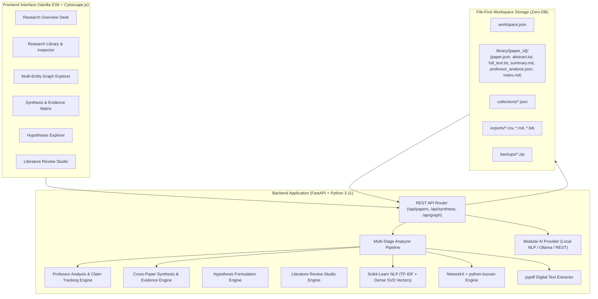

# PaperGraph

**Local-First Scientific Literature Intelligence & Knowledge Graph Workbench**

[](https://www.python.org/downloads/)
[](LICENSE)
[-A8583C.svg)](#core-architectural-pillars)
[](#system-requirements)
[](#verification--test-suite)

---

## Overview

**PaperGraph** is a local-first scientific literature intelligence platform and research laboratory designed for researchers, analysts, and students. Rather than acting as a superficial summarizer or generic chatbot, PaperGraph provides a structured environment to read papers deeply, track discrete empirical claims with epistemic rigor, evaluate consensus and controversy across literature, formulate testable hypotheses, draft literature reviews with academic citations, and navigate interactive multi-entity knowledge graphs.

PaperGraph requires **no external database servers** (no PostgreSQL, MySQL, SQL Server, MongoDB, or Docker). All authoritative research data—papers, reconstructed abstracts, full texts, structured summaries, epistemic claim matrices, vector embeddings, personal notes, and collections—is stored directly in ordinary, human-readable files (JSON, Markdown, and TXT) inside your local workspace.

---

## Core Architectural Pillars

### 1. File-First Authoritative Storage
Every paper imported into PaperGraph is organized into its own transparent directory on your filesystem. You can inspect, edit, back up, or version-control your research files with standard tools:
- `paper.json`: Bibliographic metadata, identifiers (DOI, OpenAlex ID), venue, year, citation count, and referenced works.
- `abstract.txt`: Reconstructed author abstract plain text.
- `full_text.txt`: Extracted electronic full text from local PDF, Markdown, or plain text documents.
- `professor_analysis.json` & `.md`: 6-dimension academic decomposition, pedagogical intuition, and mathematical formalism.
- `summary.md`: 8-section structured summary with explicit scope notation.
- `analysis.json`: Extracted keywords, scientific domains, methodology tags, and dense vector embeddings.
- `notes.md`: User annotations and research notes, protected against automated overwrites.

### 2. Local-First Privacy & Zero Mandatory Cloud Dependencies
Your research library stays on your computer. PaperGraph runs entirely on your local CPU by default using Scikit-learn TF-IDF and SVD feature projection for embeddings, Louvain community detection for clustering, and deterministic heuristics for discourse parsing. No paid API keys or cloud subscriptions are required.

### 3. Modular AI Engine (Local vs. Self-Hosted LLM)
PaperGraph includes a modular inference engine:
- **Default Engine**: Built-in Local Scientific NLP Engine (100% offline, deterministic, CPU-efficient, zero downloads).
- **Optional Local LLM**: Connects to your locally hosted server (e.g., Ollama at `http://localhost:11434` or LM Studio) or custom OpenAI-compatible endpoints with configurable model names and temperature.

### 4. Zero Hallucination Guarantee & Epistemic Boundaries
PaperGraph explicitly distinguishes between:
- **Directly Reported Evidence**: Empirical observations extracted from source text.
- **Derived Metrics**: Aggregated benchmark margins and statistical comparisons.
- **Analytical Inferences**: Structural syntheses generated by the analysis engine.
- **Conjectures & Hypotheses**: Speculative proposals flagged with clear uncertainty boundaries.
- **Scope Transparency**: Every summary explicitly declares whether it was derived from `Full Paper Text Analysis`, `Abstract-only Analysis`, or `Available Metadata Only`.

---

## Feature Matrix

| Capability | Scope & Mechanism | Storage Format | Offline Capable? |
| :--- | :--- | :--- | :--- |
| **OpenAlex Literature Discovery** | Live academic query over 250M+ scholarly works | Local JSON cache in `cache/` | Search requires internet; library works offline |
| **Local Folder Scanning & Ingestion** | Discovers `.pdf`, `.txt`, `.md`, `.json` non-destructively | Copied to `library/<id>/source.<ext>` | Yes |
| **Digital PDF Text Extraction** | Extracts full text and metadata using `pypdf` | Saved to `full_text.txt` | Yes |
| **Professor-Level Analysis** | 6 academic dimensions, pedagogical explanation | `professor_analysis.json` & `.md` | Yes |
| **Epistemic Claim Tracking** | Status tags (`REPORTED`, `DERIVED`, `INFERRED`, etc.) | Embedded in `professor_analysis.json` | Yes |
| **Cross-Paper Comparative Grid** | 9-dimension comparative matrix for 2–10 papers | On-demand REST computation | Yes |
| **Dynamic Evidence Matrix** | Filterable evidence table with epistemic grading | Interactive table, CSV/Markdown export | Yes |
| **Corpus Pattern Discovery** | Meta-analysis of dominant methods, datasets, limits | Aggregated across `analysis.json` | Yes |
| **Hypotheses & Inquiry Explorer** | 8-factor candidate questions & cross-pollinations | On-demand REST computation | Yes |
| **Literature Review Studio** | Thematic grouping, academic outline, citations | Markdown draft (`.md`) & BibTeX (`.bib`) | Yes |
| **Multi-Entity Knowledge Graph** | Papers, Authors, Topics, Methods, Datasets | Bundled Cytoscape.js & NetworkX | Yes |
| **Interactive Edge Explanations** | Evidence-backed relationship rationale on tap | Cytoscape element metadata | Yes |
| **8-Section Summary Generator** | Structured synthesis with honest scope declaration | `summary.md` | Yes |
| **Domain & Keyword Extraction** | TF-IDF n-grams & domain mappings | `analysis.json` | Yes |
| **Dense Vector Embeddings** | CPU-normalized feature projection (Dense SVD) | `analysis.json` | Yes |
| **Academic Export Suite** | BibTeX, JSON, CSV, and Markdown formats | Saved to `exports/` & downloaded | Yes |
| **Workspace Snapshots** | Atomic ZIP archives of library and collections | Saved to `backups/` | Yes |

---

## Research Intelligence Capabilities

### 1. Professor-Level Paper Analysis
For each paper in your collection, PaperGraph formulates a deep academic breakdown:
- **Research Problem**: Exact problem investigated, scientific motivation, foundational assumptions, prior work context, and targeted resolution.
- **Methodology & Approach**: Intuitive walkthrough, appropriateness rationale, experimental design, datasets/variables, mathematical/statistical methods, and potential weaknesses.
- **Empirical Results**: Actual observations, supporting evidence, statistical rigor (significance, effect sizes), results vs. interpretations, and justified conclusions.
- **Critical Evaluation**: Identified strengths, limitations, potential confounders, questionable assumptions, missing controls/ablations, and reproducibility threats.
- **Scientific Significance**: Primary contributions, paradigm shifts, beneficiary domains, and supported vs. speculative implications.
- **Pedagogical Walkthrough**: Pedagogical intuition (analogies bridging fundamental concepts), technical pipeline walkthrough, mathematical formalism walkthrough, potential pitfalls ("what could go wrong"), and key takeaways for researchers.

### 2. Evidence-Aware Epistemic Claim Tracking
Empirical assertions within each paper are decomposed into discrete scientific claims with assigned confidence and epistemic statuses:
```text
[REPORTED]   "Evaluations on benchmark GLUE show 94% retention with minimal throughput penalty."
[DERIVED]    "Achieves 12.4% lower relative cross-entropy loss compared to baseline."
[INFERRED]   "Investigation is bounded by quadratic memory scaling under sequence length expansion."
[HYPOTHESIS] "Orthogonal parameter updates preserve general representations across fine-tuning."
```

### 3. Cross-Paper Synthesis & Side-by-Side Comparison
Select 2 to 10 publications from your library to generate an interactive comparative desk:
- **9-Dimension Grid**: Compares Research Objectives, Methodology, Datasets & Scale, Experimental Setup, Main Observations, Assumptions, Critical Limitations, Contributions, and Future Directions.
- **Empirical Consensus**: Identifies shared problems, validated performance gains, and convergent findings across the corpus.
- **Methodological Divergence & Contextual Conflict Analysis**: Evaluates differences in benchmark environments, sample sizes, and hyperparameters to explain why papers report differing results, avoiding superficial contradictions.

### 4. Dynamic Evidence Matrix
An interactive, searchable, and sortable evidence matrix across your entire research collection:

| Publication | Methodology | Dataset / Scale | Core Observation | Critical Limitation | Epistemic Grade |
| :--- | :--- | :--- | :--- | :--- | :--- |
| **Attention Is All You Need** *(2017)* | Self-attention Transformer architecture | WMT 2014 English-German (4.5M pairs) | Outperforms recurrent models; achieves 28.4 BLEU | Quadratic memory scaling with sequence length | `High` |
| **BERT: Deep Bidirectional Pre-training** *(2019)* | Masked language modeling & next sentence prediction | BooksCorpus (800M words) + English Wikipedia (2,500M words) | Substantial gains across 11 downstream NLP tasks | Substantial pre-training compute overhead | `High` |

- Filter by method, dataset, keyword, author, or venue.
- Export as clean CSV (`.csv`) for statistical tools or Markdown (`.md`) for academic notes with one click.

### 5. Research Questions & Hypotheses Explorer
PaperGraph analyzes literature bottlenecks and structural white space to formulate candidate scientific inquiries:
1. **Methodological Cross-Pollination**: Identifies techniques from one domain (e.g., Graph Neural Networks) that remain unapplied to problems in an adjacent domain (e.g., Power Grid Cascade Dynamics).
2. **Limitation Resolution**: Synthesizes common bottlenecks into formal hypotheses for algorithmic mitigation.
3. **Frontier Synthesis**: Explores unified representation learning between complementary architectures.

Every inquiry provides an 8-factor specification:
- Title and Testable Hypothesis
- Scientific Motivation & Why Suggested
- Supporting Library Papers
- Supporting Empirical Evidence
- Contradictory or Bounding Factors
- Proposed Experimental Designs
- Epistemic Uncertainty & Confidence Score
- Additional Empirical Research Required Checklist

> **Scientific Boundary**: PaperGraph explicitly labels all generated inquiries as candidate opportunities based on local corpus patterns. They are never claimed as verified novel research gaps without a comprehensive external literature search.

### 6. Literature Review Studio
Formulate evidence-backed academic literature reviews from your library:
- **Thematic Domain Clustering**: Groups papers by conceptual and methodological families.
- **Academic Outline Structure**:
  1. *Introduction & Theoretical Motivation*
  2. *Methodological Taxonomy & Comparative Landscape*
  3. *Synthesis of Empirical Findings & Scientific Consensus*
  4. *Methodological Divergences & Contested Claims*
  5. *Critical Limitations & Frontier Research Questions*
- **Evidence-Backed Section Drafts**: Formulates academic prose with precise in-text citations (`[Author, Year]`).
- **One-Click Export**: Download as a complete Markdown manuscript (`.md`) or export verified BibTeX entries (`.bib`) ready for LaTeX and Overleaf.

### 7. Interactive Multi-Entity Knowledge Graph
Powered by **Cytoscape.js** and **NetworkX**, the knowledge graph visualizes academic literature relationships:
- **Node Entities**:
  - `Papers` (Circles): Sized by citation impact, colored by Louvain community cluster.
  - `Authors` (Diamonds): Interconnect papers through shared authorship networks.
  - `Concepts / Topics` (Rectangles): Surface shared scientific domains.
  - `Methods` (Hexagons): Highlight shared algorithmic architectures.
  - `Datasets` (Triangles): Group papers evaluated on identical benchmark corpora.
- **Edge Relationships**:
  - *Direct Citations* (Solid directed arrows)
  - *Semantic Similarities* (Dashed lines with thickness mapped to cosine similarity)
  - *Authorship Links* (Dotted lines)
  - *Methodological Links* & *Benchmark Dataset Links*
- **Interactive Edge Explanations**: Tapping any edge shows its evidence context (e.g., citation bibliography link or calculated vector similarity).
- **Layout Switcher**: Choose between `Force-Directed (cose)`, `Concentric Rings`, `Circular`, `Hierarchical (Breadthfirst)`, or `Orthogonal Grid`, with automatic non-collapsing fallback when zero edges exist.
- **High-Resolution Export**: One-click 2x raster PNG snapshot or Cytoscape JSON element export.

---

## Workspace Directory Structure

All research data is stored in human-readable files on your local drive:

```text
PaperGraph_Workspace/
│
├── workspace.json                  # Workspace configuration, active model, and preferences
│
├── library/                        # Authoritative paper repository
│   └── W2741809807/                # Unique folder for each paper (by sanitized paper ID)
│       ├── paper.json              # Bibliographic metadata, venue, year, citation links
│       ├── abstract.txt            # Reconstructed abstract plain text
│       ├── full_text.txt           # Extracted digital full text (from local PDF/TXT/MD)
│       ├── source.pdf              # Non-destructively preserved copy of local source document
│       ├── summary.md              # 8-section structured research summary
│       ├── professor_analysis.json # 6-dimension academic breakdown and discrete claims
│       ├── professor_analysis.md   # Rendered professor-level pedagogical report
│       ├── analysis.json           # Extracted keywords, domains, methods, and vector embeddings
│       ├── notes.md                # Personal annotations, critiques, and research notes
│       └── history/                # Timestamped archives of previous summaries
│
├── collections/                    # Research collections (e.g., general.json)
├── graphs/                         # Graph cache data
├── exports/                        # Exported BibTeX (.bib), CSV, JSON, and Markdown files
├── cache/                          # Temporary cache for OpenAlex API responses
├── logs/                           # System operation logs
└── backups/                        # Full timestamped ZIP snapshots of your research library
```

---

## System Requirements

- **Operating System**: Windows 10, Windows 11 (64-bit), macOS, or Linux.
- **Python**: Version 3.11 or newer.
- **Memory**: Minimum 4 GB RAM (8 GB or more recommended).
- **Disk Space**: ~250 MB for core installation and dependencies.
- **Database Server**: **None**. No SQL Server, PostgreSQL, MySQL, MongoDB, or Docker required.
- **Network**: Internet connection required for OpenAlex search queries; local folder scanning, library browsing, summaries, evidence matrices, review drafting, and knowledge graphs function 100% offline.

---

## Installation & Quick Start

### Windows Beginner Guide

You do not need prior experience with Python, virtual environments, or databases:

1. **Download or Clone PaperGraph**:
   Download this repository and place it in a folder of your choice (e.g., `C:\Users\YourUser\Desktop\PaperGraph`).

2. **Run Automated Setup**:
   Double-click `setup_windows.bat`. This automatically detects Python 3.11+, creates a localized virtual environment (`.venv`), and installs scientific dependencies (`fastapi`, `uvicorn`, `scikit-learn`, `pypdf`, `networkx`, `python-louvain`, `pandas`, `numpy`).

3. **Launch PaperGraph**:
   Double-click `run_windows.bat`. A terminal window will open, start the local server, and launch PaperGraph in your default browser at:
   ```text
   http://127.0.0.1:8000
   ```

4. **Initialize Your Workspace**:
   On first launch, enter a workspace name or leave the directory path blank to use the default `Documents\PaperGraph_Workspace`.

5. **Stop PaperGraph**:
   Click on the terminal window and press **Ctrl + C** to safely stop the server.

---

### macOS / Linux Installation

```bash
# 1. Clone repository
git clone https://github.com/Chauhan-legacy/Papergraph.git
cd Papergraph

# 2. Create and activate virtual environment
python3 -m venv .venv
source .venv/bin/activate

# 3. Install dependencies
pip install --upgrade pip
pip install -r requirements.txt

# 4. Start local research desk
uvicorn app.main:app --host 127.0.0.1 --port 8000
```

Open your browser to `http://127.0.0.1:8000`.

---

## Step-by-Step Research Workflows

### 1. Ingesting Papers from a Local Folder
1. Click **Import Folder** on the **Research Overview** desk or **Research Library**, or navigate to **Settings** -> **Research Source Directory**.
2. Enter the path to your papers folder (e.g., `C:\Users\Username\Documents\MyPapers`).
3. Click **Scan Directory**. PaperGraph discovers all `.pdf`, `.txt`, `.md`, and `.json` files, verifies text layers via `pypdf`, checks for duplicates, and presents an interactive file table.
4. Select target papers and click **Import Selected Papers**. Original files remain completely untouched—PaperGraph copies papers into its managed workspace and extracts full text into `full_text.txt`.

### 2. Discovering Literature via OpenAlex
1. Click **Literature Search** in the sidebar.
2. Enter a research topic, paper title, author, or DOI (e.g., `Graph Neural Networks` or `10.1038/s41586-021-03819-2`).
3. Use filter chips (`All`, `Topic`, `Title`, `Author`, `DOI`) and year range controls.
4. Click **+ Import to Library** on individual cards or **+ Import All Results** for batch ingestion.

### 3. Running the Multi-Stage Scientific Analyzer
1. Click **Paper Analyzer** in the sidebar.
2. Click **Start Analysis**. The autonomous pipeline processes each paper:
   - *Stage 3*: Abstract extraction & digital full-text detection.
   - *Stage 4*: 8-section structured summary formulation with scope declaration.
   - *Stage 4b*: Professor-level analysis generation & discrete claim extraction.
   - *Stage 5*: NLP domain identification, methodology tagging, and vector embedding.
   - *Stage 6*: Pairwise cosine similarity calculation.
   - *Stage 7*: Citation graph resolution.
   - *Stage 8*: Louvain community clustering.
3. Controls: Pause, resume, cancel safely, or retry failed papers at any time.

### 4. Cross-Paper Synthesis & Evidence Matrix
1. Click **Synthesis & Matrix** in the sidebar.
2. Select 2 or more publications and click **Compare Selected Papers** to view the 9-dimension comparative grid, empirical consensus, and divergence analysis.
3. Review the **Corpus Evidence Matrix** to inspect methodologies, datasets, findings, limitations, and epistemic confidence.
4. Click **Export CSV** or **Export Markdown** to download the structured matrix.

### 5. Formulating Hypotheses & Exploring Inquiries
1. Click **Hypotheses Explorer** in the sidebar.
2. Filter candidate inquiries by category (*Methodological Cross-Pollination*, *Limitation Resolution*, *Frontier Synthesis*).
3. Inspect the testable hypothesis, supporting papers, empirical evidence, limiting factors, and validation checklist.

### 6. Drafting a Literature Review
1. Click **Literature Review** in the sidebar.
2. Enter a research topic or select a collection, then click **Synthesize Review Draft**.
3. Review thematic clusters, inspect the academic outline, read the synthesized manuscript with `[Author, Year]` citations, and click **Download Draft (.md)** or **Download BibTeX (.bib)**.

---

## Technical Architecture



---

## Verification & Test Suite

PaperGraph includes a comprehensive automated test suite verifying all storage contracts, extraction pipelines, mathematical operations, epistemic boundaries, and API routes.

To execute the test suite:

```powershell
.\.venv\Scripts\python -m pytest -v
```

```text
============================= test session starts =============================
platform win32 -- Python 3.11.9, pytest-9.2.0, pluggy-1.7.0
rootdir: C:\Users\Priyansh\Desktop\PaperGraph
configfile: pytest.ini
collected 55 items

tests/test_abstract_and_summary.py ............ PASSED [ 4%]
tests/test_ai_provider.py ..................... PASSED [ 9%]
tests/test_analyzer.py ........................ PASSED [12%]
tests/test_api.py ............................. PASSED [27%]
tests/test_backups.py ......................... PASSED [29%]
tests/test_cross_paper_synthesis.py ........... PASSED [34%]
tests/test_export.py .......................... PASSED [36%]
tests/test_file_store.py ...................... PASSED [43%]
tests/test_folder_import.py ................... PASSED [49%]
tests/test_frontend_assets.py ................. PASSED [56%]
tests/test_graph.py ........................... PASSED [60%]
tests/test_graph_advanced.py .................. PASSED [65%]
tests/test_intersections_and_trends.py ........ PASSED [67%]
tests/test_literature_review.py ............... PASSED [69%]
tests/test_multi_entity_graph.py .............. PASSED [70%]
tests/test_nlp_and_embeddings.py .............. PASSED [74%]
tests/test_openalex.py ........................ PASSED [80%]
tests/test_paper_service.py ................... PASSED [85%]
tests/test_professor_analysis.py .............. PASSED [89%]
tests/test_research_hypotheses.py ............. PASSED [90%]
tests/test_summary_8_sections.py .............. PASSED [94%]
tests/test_workspace.py ....................... PASSED [100%]

============================= 55 passed in 3.03s ==============================
```

All tests execute locally using temporary directories and mocked network fixtures without requiring an active internet connection.

---

## Design System

PaperGraph is styled using an editorial scientific aesthetic inspired by contemporary design systems (Eli Horn, BrandKit by Crafted, and BrandFrame):
- **Jade Pebble Morning Palette**:
  - Base Background: `#F8F9F8` (Warm alabaster white)
  - Surface Background: `#FFFFFF`
  - Text Primary: `#1F2826` (Deep slate charcoal)
  - Text Secondary: `#4A5552`
  - Primary Accent: `#2D6A5D` (Editorial forest jade)
  - Secondary Accent: `#7B9669` (Sage green)
  - Contrast Accent: `#A8583C` (Terracotta clay)
- **Zero-Emoji Compliance**: All visual status indicators use monochromatic, semantic SVG vector icons and clean typography.
- **Editorial Typography**: Monospaced mathematical metadata, clean tabular layouts, and clear information hierarchy.

---

## Known Boundaries & Limitations

1. **PDF Text Extraction**: Local PDF extraction relies on `pypdf` and requires electronic documents with an embedded digital text layer. Scanned bitmaps or photographed pages without OCR text cannot be parsed without external OCR engines.
2. **Deterministic Heuristic vs. Generative LLM**: In default local mode, analytical extractions are generated via deterministic heuristics. While mathematically stable and hallucination-free, narrative flexibility is bounded compared to large generative models. Users desiring generative prose can connect a local Ollama server in Settings.
3. **Candidate Inquiries vs. Verified Scientific Novelty**: Suggested hypotheses reflect observational patterns within the user's local collection. PaperGraph explicitly flags these as candidate opportunities rather than verified novel contributions.

---

## License & Credits

- **License**: Released under the [MIT License](LICENSE).
- **Literature Data**: Metadata and citation networks provided by [OpenAlex](https://openalex.org/) under Creative Commons CC0.
- **Graph Visualization**: [Cytoscape.js](https://js.cytoscape.org/) (MIT License).
- **Author**: Priyansh Chauhan
